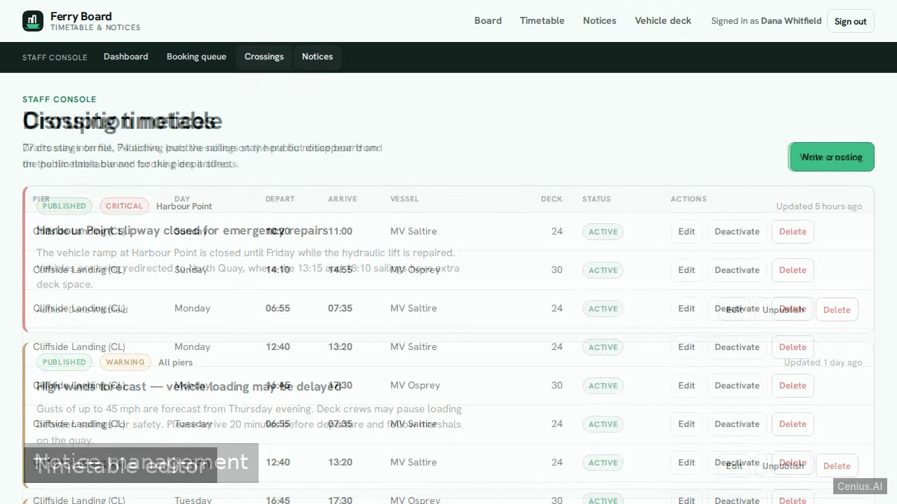
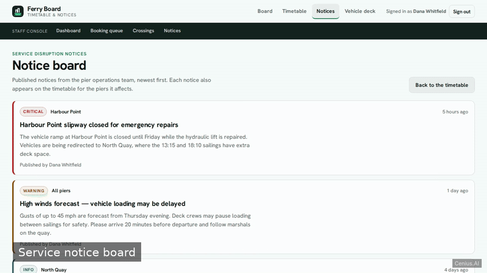
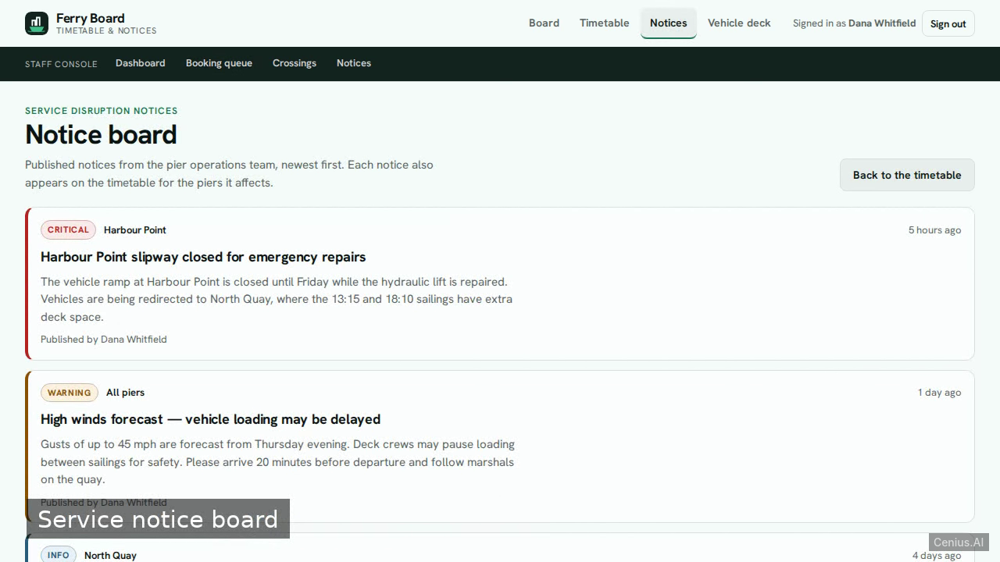
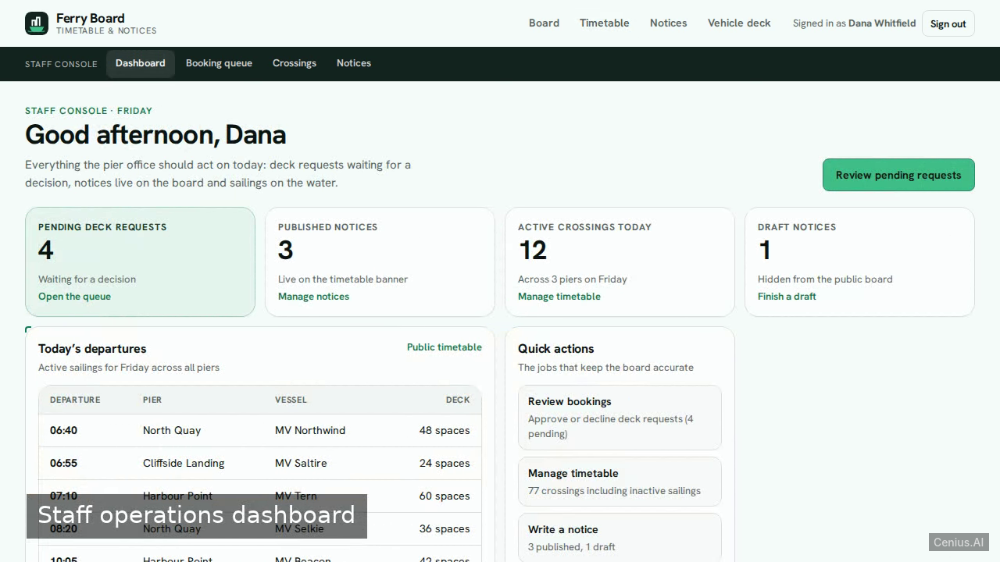
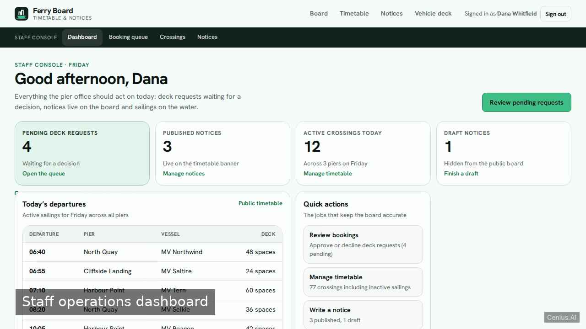

# Ferry Timetable Notice Board — complete Node.js book appointment scheduling system example app

**Ferry Timetable Notice Board** is a production-grade book appointment scheduling system written in Node.js — generated by cenius.ai, Apache-2.0-licensed. A single-file Node 20 web application (plain node:http, zero npm dependencies, no npm scripts) that publishes a per-pier, per-weekday ferry crossing timetable, surfaces service disruption notices with a four-level sev…. Clone Ferry Timetable Notice Board, run the installer, done — you have a working product in minutes. Want to change something? [Open Ferry Timetable Notice Board on cenius.ai](https://cenius.ai/marketplace/p/ferry-timetable-notice-board?ref=gh&utm_campaign=ferry-timetable-notice-board-nodejs) and say what you need — a revised build ships back, ready to deploy.


[](LICENSE)  [](https://cenius.ai)

[](https://cenius.ai/marketplace/p/ferry-timetable-notice-board?ref=gh&utm_campaign=ferry-timetable-notice-board-nodejs)

> **▶ [Open & edit in cenius.ai](https://cenius.ai/marketplace/p/ferry-timetable-notice-board?ref=gh&utm_campaign=ferry-timetable-notice-board-nodejs)** — one click to an editable workspace: describe changes in plain English, get an instant preview, one-click deploy and host. Modifications made on the platform come with full rebrand & relicense rights.

_Local clone? See [Quick start](#quick-start) below. cenius.ai is the zero-setup path._

## Demo





▶ **[Video walkthrough](https://cenius.ai/marketplace/p/ferry-timetable-notice-board?ref=gh&utm_campaign=ferry-timetable-notice-board-nodejs)** — see the app in action on the cenius.ai project page · [MP4 file](.github/media/demo.mp4)

## Screenshots

  

## Quick start

```bash
./install.sh   # installs dependencies + seeds demo data
```

See [`INSTALL.md`](INSTALL.md) for full setup and usage instructions.

## Usage guide

Everything below works against the seeded demo data, with no setup beyond
`sh install.sh` and `node .`.

### Check the next sailing

1. Open `/`. The board shows today's service status, the next departures across
   all three piers and how many crossings each pier runs today.
2. Select **Open the timetable** (or `/timetable`). The URL normalises to
   `?pier=<first pier>&weekday=<today>` so the view is shareable.
3. Change the pier or weekday selector — the table reloads without a full page
   reload and the URL follows along.
4. A weekday with no sailings shows an empty state with a **Show today's
   sailings** shortcut.

Only active crossings appear here. An inactive sailing (for example the seeded
"MV Osprey (charter)") stays in the staff timetable but never reaches the public
board.

### Read disruption notices

- `/notices` lists every published notice, newest first, with a severity badge
  (Info / Warning / Critical) and the affected pier, or **All piers**.
- On `/timetable` the banner above the table shows only the notices that affect
  the selected pier: its own notices plus the all-pier ones. With nothing
  reported it says so and links to the full notice board.

### Request vehicle-deck space

_Full guide: [`USAGE.md`](USAGE.md)_

## Features

- Staff email/password login with session
- Crossing timetable per pier and weekday
- Service disruption notices with severity
- Public vehicle deck booking request
- Staff dashboard for vehicle deck booking review
- Staff timetable editor (crossing CRUD)

## Architecture

`install.sh` takes care of packages and initial data in a single pass; nothing else is required before launching. The Node.js codebase (33 files) is self-contained — no external services needed to evaluate it. Top-level layout: `data/`, `public/`, `tests/`. Step-by-step setup guide: [`INSTALL.md`](INSTALL.md).

## FAQ

### What does it take to self-host Ferry Timetable Notice Board?

It runs entirely on your own machine. Clone, run `./install.sh`, and follow [`INSTALL.md`](INSTALL.md) — the whole stack is in this repo, no external dependencies required.

### What powers Ferry Timetable Notice Board under the hood?

Ferry Timetable Notice Board runs on Node.js. This repo holds the full production source: you can inspect every part of it before deploying. Highlights include service disruption notices with severity.

### Is it OK to ship Ferry Timetable Notice Board as part of a product?

The code is under the Apache-2.0 license, which allows commercial use without restriction. You can build, sell, and deploy it freely. Full text: [LICENSE](LICENSE).

### Is it possible to white-label Ferry Timetable Notice Board for a client?

Rebranding is straightforward under the MIT license — change what you want in the source. Or [open it on cenius.ai](https://cenius.ai/marketplace/p/ferry-timetable-notice-board?ref=gh&utm_campaign=ferry-timetable-notice-board-nodejs): the platform handles the changes and grants full rebrand rights on the result.

### Is there a no-code way to modify Ferry Timetable Notice Board?

Non-developers can use [cenius.ai](https://cenius.ai/marketplace/p/ferry-timetable-notice-board?ref=gh&utm_campaign=ferry-timetable-notice-board-nodejs) to make changes. Describe your goal in everyday language and the platform delivers an updated, ready-to-run project — zero coding on your part.

## License & rebranding

Released under the [Apache License 2.0](LICENSE) (© 2026 Cenius AI) — free for personal and commercial use. The Cenius name/logo are trademarks (see NOTICE).

**Need a customized version?** [Remix this app on cenius.ai](https://cenius.ai/marketplace/p/ferry-timetable-notice-board?ref=gh&utm_campaign=ferry-timetable-notice-board-nodejs) — modifications made on the platform come with **full rebrand & relicense rights** over your derivative.

## Built with cenius.ai

This entire application — code, design, seeded demo data — was generated on **[cenius.ai](https://cenius.ai)** from a plain-English description.

- 🚀 [Build your own app on cenius.ai](https://cenius.ai)
- 🎛️ [Remix Ferry Timetable Notice Board on the marketplace](https://cenius.ai/marketplace/p/ferry-timetable-notice-board?ref=gh&utm_campaign=ferry-timetable-notice-board-nodejs) — open it in a workspace, prompt for changes, and ship your own version.

More open-source apps: [the Cenius-ai catalog](https://github.com/Cenius-ai) · [showcase index](https://github.com/Cenius-ai/showcase)
